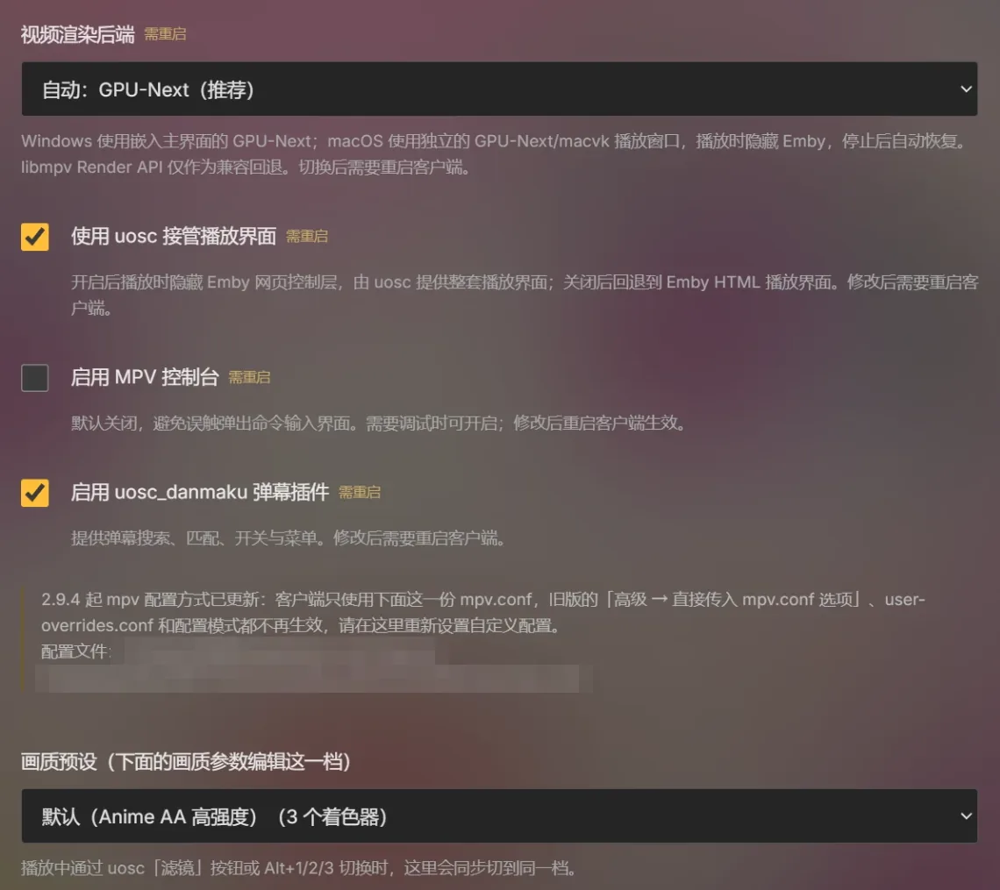

# Tigerest Theater

https://github.com/user-attachments/assets/00231384-980f-45f0-b61b-c0989a566bca

把 Emby／Jellyfin 媒体库、MPV 播放器、弹幕和作品讨论放在一起。支持 Windows、Apple Silicon Mac、iPad、Android 与 Apple TV，提供 MPV 播放、弹幕和对应平台的画质选项。

[下载正式版](https://github.com/Tigerest/Tigerest-Theater/releases/latest) · [使用教程](https://github.com/Tigerest/Tigerest-Theater/wiki) · [更新记录](CHANGELOG.md) · [反馈问题](https://github.com/Tigerest/Tigerest-Theater/issues) · [作者 B站](https://space.bilibili.com/12562485)

**当前版本：2.9.5（Windows、Android、Mac、iPhone／iPad 与 Apple TV）。** 2.9.5 起大河专属服务器的公网连接改用加密连接，升级后需要重新登录一次 Emby（Apple TV 不用）；2.9.4 及更早的版本在旧地址关闭后无法从公网连接，请尽快升级。 Wiki 源文档同步保存在 [docs/wiki](docs/wiki/Home.md)。

**已知问题：** 部分 Windows 高刷新率环境下，窗口播放可能持续卡顿、增加输出丢帧，而全屏正常。2.9.5 仍未修复；遇到此现象请先使用全屏播放。详见[故障排查](https://github.com/Tigerest/Tigerest-Theater/wiki/Troubleshooting)。

客户端不包含影视资源。你需要已有的 Emby 或 Jellyfin 服务器地址和账号；媒体库、播放与下载权限由所连接的服务器提供。本项目是非官方客户端，与 Emby LLC 及 Jellyfin 项目无隶属关系。

## 项目特色

**沉浸式首页：** 大海报、作品轮播和海报飞入详情的转场，红点与「观看进度：8/12」标出还没看完的作品；Windows 与 Mac 界面动画跟随显示器刷新率运行。

<table>
  <tr>
    <td width="50%">
      <b>五个平台都能用，画质开箱即用</b> 
      Windows、Apple Silicon Mac、iPad、Android 与 Apple TV 都能连接自己的 Emby 或 Jellyfin，各端内置 MPV 播放核心，无需另装播放器。桌面内置 shader 滤镜和画质调整，一键切换画质预设：默认档用 SSimDownscaler 改善缩小、KrigBilateral 重建色度、RAVU Zoom 放大并抗锯齿，再配合去色带与 EWA Lanczos 缩放；iPad 与 Apple TV 也能选用这套桌面预设。
    </td>
    <td width="50%"></td>
  </tr>
  <tr>
    <td width="50%"></td>
    <td width="50%">
      <b>一起看（目前仅对大河 EMBY 用户开放）</b> 
      房间里每个人都要用自己的大河 EMBY 账号登录，并有权限播放这部影片；连接自建 Emby 服务器时不显示入口。  
      创建房间后把 6 位房间码发给朋友，每个房间最多 4 人（服务器管理员账号创建的房间最多 20 人）。点「开始放映」后成员一起进入播放器、同时开始；所有人都能播放、暂停、拖动和换片，各端自动对齐进度。Windows、Android、Mac 与 iPad 2.8.0 起可用，Apple TV 暂不支持。
    </td>
  </tr>
  <tr>
    <td width="50%">
      <b>跨服务器公共评论</b> 
      不同 Emby 服务器的观众可以讨论同一部作品，按 TMDB 与播出季集关联到「作品评论」「本集评论」，收到的回复集中在消息中心。自建服务器的登录凭据不会交给评论服务；大河用户还能在详情页直接上报播放或字幕问题。
    </td>
    <td width="50%"></td>
  </tr>
  <tr>
    <td colspan="2">
      <b>弹幕自动匹配，纠正一次大家受益</b> 
      播放时按作品、季度、集标题与集数自动找弹幕，五个平台都能显示，也可以和字幕同屏，并支持搜索、切换来源和调整时间偏移。匹配错了，大河用户手动纠正一次，所有用户都能读取这份共享对应关系。  
      
      
    </td>
  </tr>
  <tr>
    <td colspan="2">
      <b>手机、折叠屏和平板同样顺手</b> 
      Android 适配手机、折叠屏和平板的横竖屏与可变窗口；Android 与 iPad 支持横滑跳转、亮度／音量手势、长按倍速和锁定；Apple TV 用遥控器浏览海报墙和选集。  
      
      
      
        
      
      
      
    </td>
  </tr>
</table>

- **桌面离线与窗口操作：** 服务器允许时可下载作品离线播放；Windows 支持边缘吸附与一键全屏／窗口切换。
- **安心更新与完整中文教程：** Windows、Mac 与 Android 应用内更新核验 SHA-256，支持暂停与断点续传；安装、一起看、弹幕、字幕、补帧和故障排查都有独立的[中文 Wiki](https://github.com/Tigerest/Tigerest-Theater/wiki)。

<table>
  <tr>
    <td width="50%"></td>
    <td width="50%">
      <b>可选 RIFE AI 补帧</b> 
      Windows NVIDIA 最高支持 4K / 60 fps 输入，可选模型并自定目标帧率；Apple Silicon Mac 与 iPad 使用 Core ML / Metal，为 1080p / 30 fps 级别的 SDR 片源输出两倍帧率。默认关闭。
    </td>
  </tr>
</table>

## 2.9.5 更新

Windows、Android、Mac、iPhone／iPad 与 Apple TV 一起发布。

- **加密连接（所有平台）：** 大河专属服务器的公网连接改用 HTTPS，评论、弹幕、一起看和检查更新都走加密连接，局域网不变。升级后需要重新登录一次 Emby；Apple TV 的登录自动换到新地址。
- **本地播放器（Windows 与 Mac）：** Windows 对视频文件右键「打开方式」选大河影院，或拖到大河影院的快捷方式上；Mac 在访达里选「打开方式 → 大河影院」，或拖到程序坞图标上。不连媒体服务器就能播放；服务器选择页和客户端菜单也有「打开本地视频」（Windows 为 Ctrl+O，Mac 为 ⌘O）。同一文件夹的视频按文件名排成播放列表，播完接下一集；已经开着时再打开文件，交给同一个窗口。本地播放不加载弹幕、不上报进度，用文件启动时也不会自动连接服务器。
- **服务器播放选集：** 从剧集页点「播放」时 Emby 只把这一集排进队列，播放列表里只有一集；现在会列出这一季的各集，可以选集和上一集／下一集。
- **页面转场（Android）：** 点下海报或媒体库后，下一个页面在 0.7 秒内就能操作（2.9.4 约 1–2 秒）；海报按下就起飞，转场中不再闪烁。
- **离线媒体与设置（Windows 与 Mac）：** 离线下载的视频播放时有声音和字幕；没连服务器时，服务器选择页的「设置」也能打开完整设置，独立设置窗口改为和媒体库里一样的左侧分组菜单。
- **统计信息（Windows 与 Mac）：** mpv 统计的第 2 页默认画出各渲染步骤的耗时曲线。
- **版本号与构建号：** 之后的小修复用四段版本号（如 2.9.5.1），2.9.5 起检查更新能识别；更新窗口显示构建号，方便确认装的是哪个包。见 [2.9.5 发布说明](docs/releases/2026-10-27-v2.9.5.md)。

## 2.9.4 更新

- **更新下载与安装：** 「直接下载」先走 GitHub 加速镜像（gh-proxy.com、ghproxy.net，最后才连 GitHub），下完仍按 GitHub 的 SHA-256 核对；夸克与百度网盘收进「备用下载」。Windows 安装版点「安装更新」后自动关闭、安装并重新打开；Android 下载后直接交给系统安装。检查更新改为先问社区服务器（服务器签名、客户端验签），连不上再问 GitHub。
- **一份可以直接改的 mpv.conf（Windows 与 Mac）：** 客户端只读取自己配置目录里的一份 `mpv.conf`，在「设置 → 播放器设置 → MPV 画质与插件」下方的编辑器里修改：逐行检查、恢复默认、粘贴前看差异、「复制给 AI」，保存后立即生效。原来的三种配置模式、「高级」页和 `user-overrides.conf` 不再使用，升级时旧内容备份到「旧版自定义配置备份.txt」。设置菜单分成「播放器设置」和「媒体库设置」两组（Android 也一样）。
- **海报转场（Windows 与 Mac）：** 点海报后直接飞向详情页的落点，不再停在半空等页面，页面按时出现时约 0.6–0.7 秒落地；返回海报墙时提前请求数据，不再出现空行；修复进入详情页偶尔闪白。Windows 的修补版 QtWebEngine 会保存 GPU 着色器缓存，重启后第一次转场不用再等编译。
- **弹幕不遮字幕：** 底部弹幕改为滚动显示，画面底部 20% 留给字幕（Windows、Mac、iPad 与 Apple TV）。
- **iPad 与 iPhone：** iPad 版改为 iPhone／iPad 通用，转屏后画面正确铺满，开着 RIFE 持续掉帧时会提示。
- **Apple TV：** 返回键先收起控制栏；海报墙可以排序和搜索，并显示观看进度；文字字幕放大约 15%。见 [2.9.4 发布说明](docs/releases/2026-10-23-v2.9.4.md)。

## 2.9.3 更新

五个平台均已发布 2.9.3。Mac、iPad 与 Apple TV 由 2.8.0 直接升级，同时带来 2.9.0 起的 Jellyfin 支持。

- **HDR：** Windows 播放 HDR 片源时，显示器支持 HDR 而系统未开启会自动开启，结束后恢复（「播放 HDR 时自动开启系统 HDR」，默认开启），并以真正的 HDR10 输出；Android 在 HDR 屏幕上把 HDR 视频直接交给系统显示，开始播放时与 Mac、iPad 一样提示 HDR／SDR 输出方式，旋转屏幕不再重启解码。
- **更新提醒：** 有新版本时每次打开软件弹窗一次，检查在后台进行、不拖慢启动；可「直接下载」（先经 GitHub 下载加速镜像，连不上再用 GitHub 原址，下载后按 GitHub 的 SHA-256 核验）；夸克与百度网盘收在「备用下载」里，直接下载失败时自动展开；也可「忽略本次更新」直到下一个版本。
- **Windows 卡死报告：** 播放器主线程卡住或视频启动超时时，自动向服务器管理员发送附带诊断日志和线程调用栈的故障报告（每次运行最多 3 份，可在客户端设置中关闭）；卡顿刚结束时开始的播放不再被误判为启动超时。
- **苹果三端支持 Jellyfin：** Mac、iPad 与 Apple TV 都可以连接 Jellyfin（10.9–12.2，含 `/jellyfin` 子路径），并记住连接过的服务器，切换失败不会丢掉当前登录。
- **Mac、iPad HDR：** 支持 HDR 的屏幕上，HDR10 与杜比视界直接以 HDR 输出，开始播放时提示输出方式；SDR 屏幕保持原来的色调映射。
- **Mac：** 更新提醒与 Windows 规则相同；界面继续跟随显示器刷新率，120 Hz 屏上约 120 帧。
- **iPad：** 10 位 SDR 片源开启 RIFE 后长时间播放不再持续掉帧（颜色转换改用 Metal）；戴 AirPods 时多声道音轨可用空间音频；支持妙控键盘调音量、快进快退和按住右键倍速。
- **Apple TV：** 同步升级与 Jellyfin 支持，戴 AirPods 时多声道音轨同样可用空间音频；暂不提供「一起看」和 RIFE。见 [2.9.3 发布说明](docs/releases/2026-10-21-v2.9.3.md)。

## 2.9.1 更新（Windows、Android）

- **Jellyfin 默认主题：** 服务器提供的自定义 CSS 默认禁用，手机和电脑都按 Jellyfin 默认主题显示，避免服务器主题与客户端外观互相冲突；在 Jellyfin「显示」设置里取消勾选「禁用服务器提供的自定义 CSS」即可恢复，客户端会保留你的选择。
- **默认主题细节：** 海报圆角外不再露出深色直角；触屏设备上标签栏下方不再出现灰色滚动条。
- **触屏首页：** 在 Jellyfin 首页横滑海报轨、媒体库行或主视觉时，不再误切到「我的最爱」标签。
- **详情页与动画：** Jellyfin 手机详情页顶部补上横向背景图；海报飞行等新页面稳定后再起飞，Android 上不再卡顿；Emby 手机竖屏单集页顶部图片完整显示，从作品详情进单集的海报动画能正常落地。
- **共享修复：** 合入 Mac 回传的页面切换、详情页评论区对齐与卡片跳转动画等共享修复。见 [2.9.1 发布说明](docs/releases/2026-10-20-v2.9.1.md)。

## 2.9.0 更新重点（Windows、Android）

- **Jellyfin 服务器：** 在「自建服务器」里填写 Jellyfin 地址（反向代理的 `/jellyfin` 等子路径要保留），用该服务器的账号登录。已在 Windows 和 Android 上用 Jellyfin 10.9.11、10.10.7、10.11.0、10.11.11 与 12.2 实际登录和播放。说明见 [Jellyfin 连接与兼容范围](docs/jellyfin-compatibility.md)。
- **服务器列表与「客户端」菜单：** 连接过的自建 Emby／Jellyfin 服务器会记在切换服务器页面，点卡片即可切换，也可以编辑地址或移除。顶栏的 MPV 设置和切换服务器合并为一个「客户端」菜单。
- **Windows 花屏修复：** 首页轮播空闲、窗口被其他窗口挡住时偶尔出现的整页花屏和闪屏，改为 GPU 双向同步后，同条件测试中不再出现。
- **首页与媒体库：** 首页轮播换作品时新旧海报交叉淡化，不再闪暗；进入媒体库时整页飞入，不再先显示加载圈。
- **Android 折叠屏：** 在外屏启动应用后，Jellyfin 不再切到手机布局；媒体库首行不再被标签栏盖住，展开后详情页海报不再压住标题，媒体库滚动恢复到接近 120 fps。
- **首页重复作品：** 服务器上同一部作品有两个条目时，首页按作品身份合并为一张卡（原定于 2.8.1，未单独发布，并入本版）。

苹果三端的 Jellyfin 支持随 2.9.3 发布。完整范围与验证见 [2.9.0 发布说明](docs/releases/2026-10-19-v2.9.0.md)。

## 2.8.0 更新重点

- **一起看（Windows、Android、Mac、iPad）：** 目前仅对大河 EMBY 用户开放。登录大河服务器后，可以和朋友组一个房间同时观看同一部影片，房间里每个人都要用自己的大河 EMBY 账号登录。把 6 位房间码发给朋友即可加入，每个房间最多 4 人；所有成员都可以播放、暂停、拖动和换片。
- **一起开始：** 点「开始放映」后，房间页上的成员一起进入播放器，全部加载完成后同时开始；播放中各客户端自动对齐进度，中途加入的成员会追上。
- **入口：** 顶栏「消息」左边，以及电影、剧集详情页「播放」旁边（取代原来的「预告片」按钮）。选片页列出当前页面、本剧其他集、继续观看和最近添加。
- **评论账号自助修改：** 独立评论账号可以修改显示昵称和密码，注册和改密码时再输入一次密码确认。
- **首页媒体夹：** 「首页 → 首页媒体夹」可以隐藏媒体夹、调整顺序，按服务器和账号保存在本机。
- **播放修复：** 服务器给出的播放地址不带令牌时不再报 401；302 跳转到其他主机时不再把令牌带过去。
- **iPad 持续补帧：** 优化 RIFE 的 GPU 颜色转换与异步调度，保留原模型和画质预设；开启 RIFE 时避免房间同步反复微调倍速而打断补帧。
- **Mac 与首页：** 保留 Mac 高刷新率界面优化；修复苹果三端首页中同一作品重复出现，合并时保留继续观看信息。
- **Apple TV：** 更新版本与作品去重，提供海报墙、选集、字幕、弹幕、详情页评论和画质选项。电视端暂不包含「一起看」和 RIFE。

五个平台的安装包均已在同一发行页提供。「一起看」、评论账号自助修改和首页媒体夹设置适用于 Windows、Android、Mac 与 iPad；Apple TV 的线上房间服务尚未支持，暂不开放「一起看」。Mac／iPad 房间功能已通过隔离数据测试，真实跨设备多人播放尚未验证；补帧流畅度仍取决于片源与设备负载。完整范围与验证见 [2.8.0 发布说明](docs/releases/2026-10-16-v2.8.0.md)。

iPad 与 Apple TV 的 IPA 均未签名，需使用自己的 Apple 身份签名安装；两种设备包不能互换，也不提供 App Store／TestFlight 分发。见 [iPad 安装说明](docs/apple/INSTALL.md)与 [Apple TV 安装与构建](apple/TV/README.md)。

## 下载与安装

| 平台 | 安装包 | 系统要求 |
| --- | --- | --- |
| Windows 安装版 | [2.9.5 EXE](https://github.com/Tigerest/Tigerest-Theater/releases/download/v2.9.5/TigerestTheater-2.9.5-x64.exe) | Windows 10 1903+ / Windows 11，x64 |
| Windows 便携版 | [2.9.5 ZIP](https://github.com/Tigerest/Tigerest-Theater/releases/download/v2.9.5/TigerestTheater-2.9.5-x64.zip) | 同上；完整解压后运行 |
| Android | [2.9.5 APK](https://github.com/Tigerest/Tigerest-Theater/releases/download/v2.9.5/TigerestTheater-2.9.5-android.apk) | Android 15+，arm64-v8a / x86_64 |
| Apple Silicon Mac | [2.9.5 DMG](https://github.com/Tigerest/Tigerest-Theater/releases/download/v2.9.5/TigerestTheater-2.9.5-arm64.dmg) | macOS 26+，M 系列芯片 |
| iPad / iPhone | [2.9.5 IPA](https://github.com/Tigerest/Tigerest-Theater/releases/download/v2.9.5/TigerestTheater-2.9.5-universal.ipa) | iPadOS / iOS 26+，须自行签名安装 |
| Apple TV | [2.9.5 IPA](https://github.com/Tigerest/Tigerest-Theater/releases/download/v2.9.5/TigerestTheater-2.9.5-tvos.ipa) | tvOS 26+，须为 Apple TV 签名安装 |

包内已包含 MPV 和基础运行库，无需另装播放器。Windows RIFE 大型组件是可选扩展；已有 NVIDIA 1.0.0 扩展可以继续使用。正式 Mac 下载仅提供 Apple Silicon 版本。

无法访问 GitHub 时，可从[夸克网盘](https://pan.quark.cn/s/88e6f7a795b4)或[百度网盘](https://pan.baidu.com/s/58azzOU4piiB3miyZqA1dig)下载 Windows／Android 安装包，每个版本一个文件夹，内容与发行页附件相同；Mac、iPad 与 Apple TV 的安装包目前只在 GitHub 发行页提供。

全部平台使用同一份 [2.9.5 SHA-256 校验清单](https://github.com/Tigerest/Tigerest-Theater/releases/download/v2.9.5/TigerestTheater-2.9.5-SHA256SUMS.txt)。来源与验证记录见发行页的 `RELEASE-MANIFEST.json` 附件。

### 第一次使用

1. 下载对应平台安装包。Windows 安装版运行向导；便携版完整解压；Mac 将应用拖入「应用程序」；Android 安装 APK；iPad／Apple TV 按上述说明签名并安装对应 IPA。
2. 打开客户端，选择「大河李斯特专属 EMBY」或「自建服务器」。
3. 自建 Emby／Jellyfin 服务器填写完整地址，例如 `http://192.168.1.100:8096`、`https://example.com/emby` 或 `https://example.com/jellyfin`，然后使用该服务器账号登录。
4. 进入作品详情并播放。桌面与移动端可在 Emby 设置中的「Tigerest Theater 设置」调整播放选项；Apple TV 使用原生页面和播放器菜单，画质从页面顶部「画质」进入。
5. 想参与公共讨论时，大河用户可直接进入评论区；自建用户点击「评论账号」注册或登录；Apple TV 请使用已有的公共评论账号登录。

专属服务器的权限与开通说明请查看[作者 B站主页](https://space.bilibili.com/12562485)中的充电说明；下载客户端不会自动获得服务器权限。

Windows 安装包目前未做 Authenticode 签名。Mac 使用 ad-hoc 签名，尚未经过 Apple 公证；确认文件来自本项目后，可按系统提示在「系统设置 → 隐私与安全性」中允许打开。详细步骤见 [安装与更新](https://github.com/Tigerest/Tigerest-Theater/wiki/Installation)。

### 从旧版更新

Windows、Mac 与 Android 客户端启动时后台检查正式版本；有新版本时每次打开软件弹窗一次，可「从GitHub获取更新」、从夸克或百度网盘下载，或「忽略本次更新」直到下一个版本，右上角更新图标也会显示红点。也可在「客户端」设置中点击「检查客户端更新」。下载会核验文件大小与 SHA-256，支持暂停、继续和中断后的续传；Android 下载完成后交给系统安装器确认安装。

手动更新前完全退出客户端，包括 Windows 托盘。安装版覆盖安装；便携版备份并保留 `data`，使用完整新版文件；Mac 替换应用；Android 使用同签名正式 APK 覆盖安装。iPad 与 Apple TV 重新签名后覆盖安装，保留原应用标识和签名身份，不要先卸载。

iPad 应用内仅检查和提示更新，不自动替换安装；Apple TV 暂无内置更新检查，请从发行页获取新版。

旧版 Windows 的内置下载若反复失败，可从发行页手动安装一次。具体操作、跳过版本和校验方式见 [安装与更新](https://github.com/Tigerest/Tigerest-Theater/wiki/Installation)。

## 能做什么

### 浏览与播放

沉浸式首页展示当前账号可访问的媒体库和作品。首页默认按观看记录排列：看过的作品按最近一次观看在前，看过后又有新一集入库的剧集随之提前，从未播放的作品按最近入库在后；也可改为最近入库、发行时间或评分。内置 MPV 支持音轨、字幕、播放队列、选集和观看进度回传。

首页海报用红点标记尚有未观看内容的作品；剧集显示「观看进度：8/12」，表示已看 8 集、当前服务器共有 12 集。观看进度在首页显示后加载，播放返回时刷新。

桌面默认使用 GPU-Next，并提供 Render API 兼容模式。Windows 播放画面嵌入主窗口，Mac 使用独立播放窗口。设置分「播放器设置」（客户端、视频、音频、字幕、MPV 画质与插件、弹幕样式）和「媒体库设置」两组，支持搜索、即时保存与分类恢复默认值；高级用户可以在 MPV 画质与插件页直接编辑 mpv.conf。

Android 提供双击暂停、横滑跳转、左右侧亮度／音量调节、长按临时倍速、防误触锁及选集。系统关闭自动旋转时保留当前方向。详见 [播放与设置](https://github.com/Tigerest/Tigerest-Theater/wiki/Playback)。

iPad 支持横滑跳转、左右侧亮度／音量调节、长按临时倍速、锁定和季集选择，播放时隐藏系统状态栏；接妙控键盘时上／下键调音量、左／右键快退／快进 15 秒、按住右键临时倍速。戴 AirPods 播放 5.1／7.1 音轨时保留多声道，可开启系统空间音频。

Mac 与 iPad 在支持 HDR 的屏幕上把 HDR10 与杜比视界直接以 HDR 输出，开始播放时提示输出方式和色彩空间；SDR 屏幕保持色调映射。Apple TV 使用遥控器操作首页与海报墙，支持选季选集、上一集／下一集、字幕选择和详情页内评论；电视端暂不提供音轨选择、离线下载、直播或服务端转码，完整范围见 [电视端说明](apple/TV/README.md)。

### 公共评论、头像与消息

电影和剧集按可靠的 TMDB 标识关联公共讨论；单集还需要明确的播出季集编号。详情页区分「作品评论」「本集评论」，每页 10 条主评论，可回复和删除自己的内容，正文最多 2000 字。

自建用户必须登录独立评论账号后才能读取或发送评论。这个账号与 Emby 账号分开；头像来自当前 Emby 的本人头像，发言时检查变化并按需同步。大河用户免注册，头像由服务端同步。

顶栏「消息」提供收到的消息与我的发言；大河用户还可查看我的报错及修复通知。详情页不再切换公共／本服评论；大河自动使用统一评论入口，保留旧回复、管理工具和私人问题上报，自建服务器使用公共评论账号。

缺少可靠作品编号或使用不支持的集序时，客户端会说明原因，避免把不同集数混到一起。参见 [评论账号与头像](https://github.com/Tigerest/Tigerest-Theater/wiki/Community) 和 [消息与私人报错](https://github.com/Tigerest/Tigerest-Theater/wiki/Messages-and-Reports)。

Apple TV 使用原生详情页评论区，支持作品／单集切换、分页、回复和管理自己的评论；公共账号需使用已有账号登录，暂不提供公共账号注册、管理审核或与桌面相同的顶栏消息页。

### 弹幕与共享校准

新配置默认启用弹幕，已有明确关闭的设置会保留。播放时先查共享匹配，再按作品、季度、集标题与集数自动识别；仍有歧义时可手动选择。

桌面与 Android 均可搜索、管理来源、调整时间偏移和样式。大河用户手动选择正确的作品与集数后，可使用当前 Emby 登录保存共享对应关系；保存失败仍能加载本次选择，并显示提示。自建用户可读取共享结果。

桌面内置弹幕下载和共享查询遇到超时或临时网络故障会等待 1 秒后自动重试一次；空结果和限流不反复请求，切集或手动换源会取消旧请求。

视频来自你的 Emby；弹幕搜索和匹配信息会发送到所用弹幕服务。手动配置的第三方来源保留原设置。操作示例见 [弹幕匹配与纠正](https://github.com/Tigerest/Tigerest-Theater/wiki/Danmaku)。

iPad 与 Apple TV 复用作品搜索和匹配规则，提供原生弹幕渲染，以及搜索、来源和时间偏移调整。

### 画质与 AI 补帧

桌面内置默认 Anime AA、真人影视、激进测试 Anime4K 三档画质；可以从菜单切换，也可以使用 `Alt+1`～`Alt+3`。日常先使用默认档，再按片源和设备调整。

RIFE 默认关闭，需要大河内置播放配置：

| 平台 | RIFE 方式 | 输入范围 |
| --- | --- | --- |
| Windows NVIDIA | 下载或离线导入 NVIDIA 1.0.0 扩展；三个 4.25 系列模型与可调目标帧率 | 最高逐行 SDR 4K / 60 fps；实际实时性能取决于设备和设置 |
| Apple Silicon Mac | 模型与插件随包提供，使用 Core ML / Metal | 最高逐行 SDR 1080p / 30 fps、恒定帧率，输出两倍帧率 |
| iPad | 随包 Core ML / Metal 原生滤镜，默认关闭 | 1920×1080、BT.709 SDR（8 位或 10 位）、23–30 fps，固定两倍；其他规格原帧通过 |
| Android | 暂不提供 RIFE | 使用基础播放 |
| Apple TV | 暂不提供 RIFE | 可选原生、轻量增强及桌面画质预设 |

Apple TV 的轻量增强会在高帧率视频或持续渲染掉帧时暂时降低当前视频的处理负载，并保留所选设置。完整桌面滤镜在较早电视设备上仍可能掉帧。

首次 Windows 引擎准备可能需要数分钟。高目标帧率、4K 和重型模型会增加负载；屏幕刷新率不代表补帧推理能力。详细安装、目标帧率计算和排查见 [RIFE 补帧](https://github.com/Tigerest/Tigerest-Theater/wiki/RIFE)。

### 桌面离线媒体

服务器允许下载时，可创建下载任务，暂停、恢复或删除，并从下载与离线媒体管理中播放已完成文件。Android 当前不提供离线下载、后台持续播放或画中画。参见 [下载与离线播放](https://github.com/Tigerest/Tigerest-Theater/wiki/Downloads)。

## 中文 Wiki

| 我想要…… | 教程 |
| --- | --- |
| 从头开始使用 | [教程首页](https://github.com/Tigerest/Tigerest-Theater/wiki/Home) |
| 安装、更新、核验下载 | [安装与更新](https://github.com/Tigerest/Tigerest-Theater/wiki/Installation) |
| 连接自己的服务器或更换账号 | [服务器与登录](https://github.com/Tigerest/Tigerest-Theater/wiki/Server) |
| 和朋友一起看同一部影片 | [一起看](https://github.com/Tigerest/Tigerest-Theater/wiki/Watch-Together) |
| 注册评论账号、改密码、更新头像 | [公共评论与头像](https://github.com/Tigerest/Tigerest-Theater/wiki/Community) |
| 找回复、查看修复通知、上报问题 | [消息与私人报错](https://github.com/Tigerest/Tigerest-Theater/wiki/Messages-and-Reports) |
| 弹幕匹配错集、调时间或来源 | [弹幕教程](https://github.com/Tigerest/Tigerest-Theater/wiki/Danmaku) |
| 调播放、声音、画质或 Android 手势 | [播放与设置](https://github.com/Tigerest/Tigerest-Theater/wiki/Playback) |
| 选择字幕、修正延迟、保留 ASS 特效 | [字幕教程](https://github.com/Tigerest/Tigerest-Theater/wiki/Subtitles) |
| 安装与调试 AI 补帧 | [RIFE 教程](https://github.com/Tigerest/Tigerest-Theater/wiki/RIFE) |
| 下载作品并离线播放 | [下载管理](https://github.com/Tigerest/Tigerest-Theater/wiki/Downloads) |
| 在 Apple TV 上使用 | [Apple TV](https://github.com/Tigerest/Tigerest-Theater/wiki/Apple-TV) |
| 解决异常或准备反馈 | [故障排查](https://github.com/Tigerest/Tigerest-Theater/wiki/Troubleshooting) · [常见问题](https://github.com/Tigerest/Tigerest-Theater/wiki/FAQ) |
| 了解各客户端的实现与架构 | [技术原理](https://github.com/Tigerest/Tigerest-Theater/wiki/Architecture) |
| 查看用到的开源项目和许可证 | [引用来源与鸣谢](https://github.com/Tigerest/Tigerest-Theater/wiki/Credits) |

## 反馈与支持

播放器问题请提交 [GitHub Issue](https://github.com/Tigerest/Tigerest-Theater/issues)，写明客户端版本、系统、复现步骤与错误提示。日志和截图请先删除密码、访问令牌及私人服务器信息。大河某部作品的播放或字幕问题，可直接在详情页「上报问题」中提交。

项目动态与支持入口：[大河李斯特视频工作室 / 大老师的 B站主页](https://space.bilibili.com/12562485)。

## Star 趋势

觉得好用的话，欢迎点个 Star。

<a href="https://www.star-history.com/#Tigerest/Tigerest-Theater&Date">
  <picture>
    <source media="(prefers-color-scheme: dark)" srcset="https://api.star-history.com/svg?repos=Tigerest/Tigerest-Theater&type=Date&theme=dark">
    <source media="(prefers-color-scheme: light)" srcset="https://api.star-history.com/svg?repos=Tigerest/Tigerest-Theater&type=Date">
    
  </picture>
</a>

## 贡献者

- [大河李斯特（Tigerest）](https://github.com/Tigerest)：项目维护、开发与发布。
- [Claude](https://github.com/claude)：AI 辅助开发。
- [Codex](https://github.com/codex)：AI 辅助开发、调试与验证。

## 开发与许可

客户端源码在本仓库维护，评论和弹幕服务端单独维护。公开客户端源码不包含服务器资源、账号或访问权限。

- [Windows 构建](dev/windows/README.md)
- [macOS 构建](dev/macos/README.md)
- [Android 构建](android/README.md)
- [iPad 安装与构建](docs/apple/INSTALL.md)
- [Apple TV 安装与构建](apple/TV/README.md)
- [Windows 测试环境要求](dev/windows/TESTING.md)
- [版本变化](CHANGELOG.md)与本次发布说明（[2.9.5](docs/releases/2026-10-27-v2.9.5.md)、[2.9.4](docs/releases/2026-10-23-v2.9.4.md)、[2.9.3](docs/releases/2026-10-21-v2.9.3.md)、[2.9.1](docs/releases/2026-10-20-v2.9.1.md)、[2.9.0](docs/releases/2026-10-19-v2.9.0.md)、[2.8.0](docs/releases/2026-10-16-v2.8.0.md)）

Windows 每次运行原生测试前，都必须在同一个 PowerShell 调用中加载测试环境脚本并完成运行库预检。测试、包启动检查、生产 API 联调和真实媒体播放的覆盖范围分别记录，不能互相替代。

主项目许可证见 [LICENSE](LICENSE)（GNU GPL v2）；第三方组件按各自许可证分发，具体来源、修改及许可文件随源码和发行包提供。

## 引用来源与鸣谢

Tigerest Theater 建立在许多开源项目之上。下面按用途列出直接使用或改造的主要项目，不是完整清单；各组件的版本、来源、修改和许可证随源码与发行包提供（桌面见 [licenses.txt](resources/misc/licenses.txt)，Android 见 [licenses](android/app/src/main/assets/licenses/NOTICE.txt)，Windows 补帧扩展见 [extension-NOTICE.txt](dev/windows/rife/extension-NOTICE.txt)）。完整列表和许可证见 Wiki 的[引用来源与鸣谢](https://github.com/Tigerest/Tigerest-Theater/wiki/Credits)。

**客户端与界面**

- [Jellyfin Desktop](https://github.com/jellyfin/jellyfin-desktop)：Windows 与 Mac 客户端的 Qt 架构和代码基础，连同其中的 mpvqt、HIDRemote、LetsMove 等组件。
- [Qt](https://www.qt.io/) 与 QtWebEngine：桌面界面和网页层；Windows 与 Mac 使用打过补丁的 QtWebEngine，让网页动画跟随显示器刷新率。
- [Emby](https://emby.media/) 与 [Jellyfin](https://jellyfin.org/)：Windows、Mac、Android 和 iPad 的媒体库页面就是所连接服务器自带的网页端；部分界面文字取自 [jellyfin-web](https://github.com/jellyfin/jellyfin-web) 的翻译。

**播放核心**

- [mpv](https://mpv.io/) 与 [FFmpeg](https://ffmpeg.org/)：各平台的播放和解码内核，字幕与渲染还用到 libass、libplacebo、dav1d、HarfBuzz、FreeType、FriBidi 等。
- [mpv-winbuild-cmake](https://github.com/shinchiro/mpv-winbuild-cmake)（shinchiro）：Windows 的 libmpv；补帧用的 libmpv 也按这套配方加补丁自建。
- [mpv-android](https://github.com/mpv-android/mpv-android)：Android 内置的 libmpv 与 JNI 桥，原样使用正式版。
- [MPVKit](https://github.com/mpvkit/MPVKit)：iPhone、iPad 与 Apple TV 的 libmpv、FFmpeg 及依赖。
- [MoltenVK](https://github.com/KhronosGroup/MoltenVK)：在 Mac 和苹果设备上把 Vulkan 渲染转到 Metal。
- [uosc](https://github.com/tomasklaen/uosc)（tomasklaen）：桌面播放器的控制界面。

**弹幕**

- [uosc_danmaku](https://github.com/Tony15246/uosc_danmaku)（Tony15246）：桌面弹幕插件，本项目在它的基础上修改；插件里也用到 [rkscv/danmaku](https://github.com/rkscv/danmaku) 等项目的代码。
- [弹弹play](https://www.dandanplay.com/)：弹幕搜索和下载沿用弹弹play 开放平台的接口格式。

**画质着色器**

- [Anime4K](https://github.com/bloc97/Anime4K)（bloc97）
- [ArtCNN](https://github.com/Artoriuz/ArtCNN) 与 CfL 色度预测（João Chrisóstomo 等）
- [FSRCNNX](https://github.com/igv/FSRCNN-TensorFlow)、SSimDownscaler 与 SSimSuperRes（igv）
- [RAVU](https://github.com/bjin/mpv-prescalers)（bjin）与 KrigBilateral（Shiandow）
- 着色器的整理版本和参数说明参考 [mpv_PlayKit](https://github.com/hooke007/mpv_PlayKit)（hooke007）。

**AI 补帧（RIFE）**

- [Practical-RIFE](https://github.com/hzwer/Practical-RIFE)（hzwer）：RIFE 补帧模型；Mac 与 iPad 上转换为 Core ML 运行。
- [VapourSynth](https://github.com/vapoursynth/vapoursynth)：Windows 与 Mac 补帧的视频处理框架。
- [vs-mlrt](https://github.com/AmusementClub/vs-mlrt)（AmusementClub）：Windows NVIDIA 补帧扩展的 TensorRT 推理和 ONNX 模型；NVIDIA TensorRT 与 CUDA 运行库按 NVIDIA 许可原样分发。

**字体与其他**

- [思源宋体](https://github.com/adobe-fonts/source-han-serif)与[思源黑体](https://github.com/adobe-fonts/source-han-sans)（Adobe）：桌面内置字体，以及 iPad 与 Apple TV 的默认字幕字体。
- Kotlin、AndroidX 与 [OkHttp](https://github.com/square/okhttp)：Android 客户端；[OpenSSL](https://www.openssl.org/)：Windows 的加密连接；[Inno Setup](https://jrsoftware.org/isinfo.php)：Windows 安装程序。

感谢以上项目的作者和贡献者，也感谢 Emby 与 Jellyfin 社区。感谢在 GitHub Issue、B站和客户端「上报问题」里反馈问题的用户。上述名称和商标归各自所有者所有，本项目与它们没有隶属关系。
