# 技术原理

这一页介绍 Tigerest Theater 的实现方式：五个客户端各用什么技术、哪些代码是共用的，以及播放、一起看、评论、弹幕和更新的数据怎样流动。内容对应 2.9.4。日常使用不需要读这一页，操作说明见[教程首页](https://github.com/Tigerest/Tigerest-Theater/wiki/Home)。

## 总览

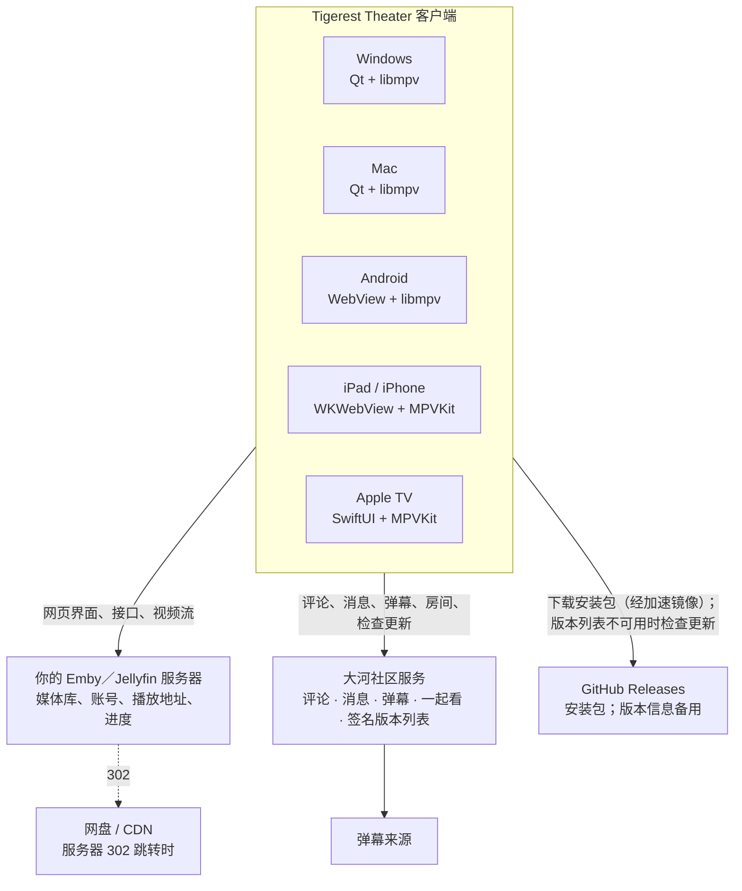

- **客户端不带媒体，视频也不经过本项目的服务。** 播放器直接从你连接的 Emby 或 Jellyfin 服务器拉流；服务器把请求 302 跳转到网盘或 CDN 时，播放器跟着跳转。媒体库、账号权限和观看进度都由 Emby 管理。
- **社区服务**是本项目自己维护的服务端，源码不随客户端公开。评论、消息、弹幕网关、共享弹幕匹配和一起看运行在同一个进程里，只处理文字、匹配关系和房间状态，不接触视频流。社区服务暂时不可用时，浏览和播放不受影响。
- **更新检查**先读社区服务签名的版本列表，连不上或验签失败时再读 GitHub Releases 的公开接口；安装包从 GitHub 发行页下载（经加速镜像），按 GitHub 给出的 SHA-256 核验。见下文[更新](#更新)。

## 代码在哪里

客户端源码都在[项目仓库](https://github.com/Tigerest/Tigerest-Theater)里：

| 目录 | 内容 | 用于 |
| --- | --- | --- |
| `src/` | Qt / C++ 桌面程序：窗口、播放器组件、设置、更新器、评论桥、RIFE 控制 | Windows、Mac |
| `native/` | 注入 Emby／Jellyfin 网页的扩展脚本：播放器插件、首页、评论、一起看、设置页、更新提示 | Windows、Mac、Android、iPad／iPhone |
| `resources/mpv/` | 内置 MPV 配置和 Lua 插件：uosc 控制栏、uosc_danmaku 弹幕、画质菜单、播放统计 | Windows、Mac |
| `android/` | Kotlin 应用：网页宿主、原生桥、播放器、手势、弹幕、更新 | Android |
| `apple/Core/` | AppleCore Swift 包：Emby／Jellyfin 接口、首页数据、评论、弹幕匹配与排版、设置规则 | iPad／iPhone、Apple TV |
| `apple/App/` | iPad／iPhone 通用应用：网页宿主、原生桥、播放器、下载、弹幕 | iPad／iPhone |
| `apple/TV/` | Apple TV 的原生界面与播放 | Apple TV |
| `apple/NativeRIFE/` | iPad 的 RIFE 视频滤镜 | iPad |

桌面程序沿用 [Jellyfin Desktop](https://github.com/jellyfin/jellyfin-desktop) 的 Qt 架构改造而来。播放内核在各平台都是 [MPV](https://mpv.io/)：桌面使用 libmpv，Android 使用 [mpv-android](https://github.com/mpv-android/mpv-android) 正式包中的 libmpv，iPad 和 Apple TV 使用 [MPVKit](https://github.com/mpvkit/MPVKit)。各平台依赖都固定版本并记录哈希。

## 共用的网页界面

Windows、Mac、Android 和 iPad／iPhone 的媒体库界面就是服务器自带的网页端：连接 Emby 时是 Emby 网页，连接 Jellyfin 时是 Jellyfin 网页。客户端打开服务器的 `web/index.html`，在页面自己的脚本运行之前注入本项目的扩展脚本。所以浏览、搜索、详情这些页面跟随服务器版本（Emby 兼容 4.8–4.10，Jellyfin 兼容 10.9–12.2，包括 12.2 的 Modern 与 Legacy 两种布局），而沉浸式首页、评论区、一起看、「播放器设置」分组和更新提示是扩展脚本加上去的。

两种网页加载扩展的方式不同：Emby 把功能注册成 AMD 模块（`embycompat.js`），Jellyfin 通过自己的 NativeShell 插件接口创建插件（`jellyfinPlugin.js`），并按地址里的 hash 而不是 Emby 的页面管理器切换视图。扩展脚本据此分别接入首页、转场和播放器；同一份播放器插件在两边都注册为 MPV 播放器。

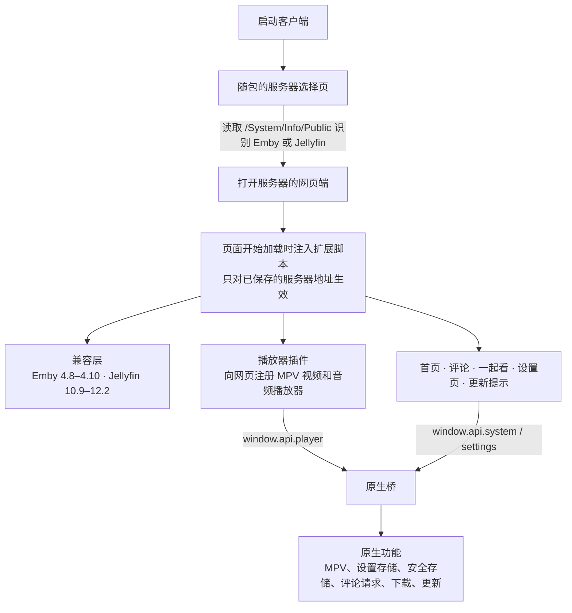

四个平台运行同一份扩展脚本。脚本只调用 `window.api` 这一组接口，各平台在背后用自己的方式实现：

| 平台 | 网页引擎 | 页面与原生之间怎样通信 |
| --- | --- | --- |
| Windows / Mac | QtWebEngine（Chromium） | Qt WebChannel：C++ 组件直接注册成页面里的对象 |
| Android | Android System WebView | 页面开始加载时注入脚本；用 WebMessageListener 收发 JSON 消息，由 androidBridge.js 包装成同样的 `window.api` |
| iPad／iPhone | WKWebView | 用 WKUserScript 注入脚本；用 WKScriptMessageHandler 接收、`callAsyncJavaScript` 回传，由 ipadBridge.js 包装成同样的 `window.api` |

原生层在启动时告诉页面本平台有哪些能力（能否下载、能否补帧、能否自动安装更新等），脚本据此显示或隐藏对应功能。Android 和 iPad／iPhone 构建时从 `native/` 复制这些脚本，不另写一份。

原生桥只接受当前服务器来源、主框架页面发来的消息。切换服务器或页面重新加载时，上一页还没完成的请求一律作废，旧页面的回复不会送到新页面。

## 播放链路

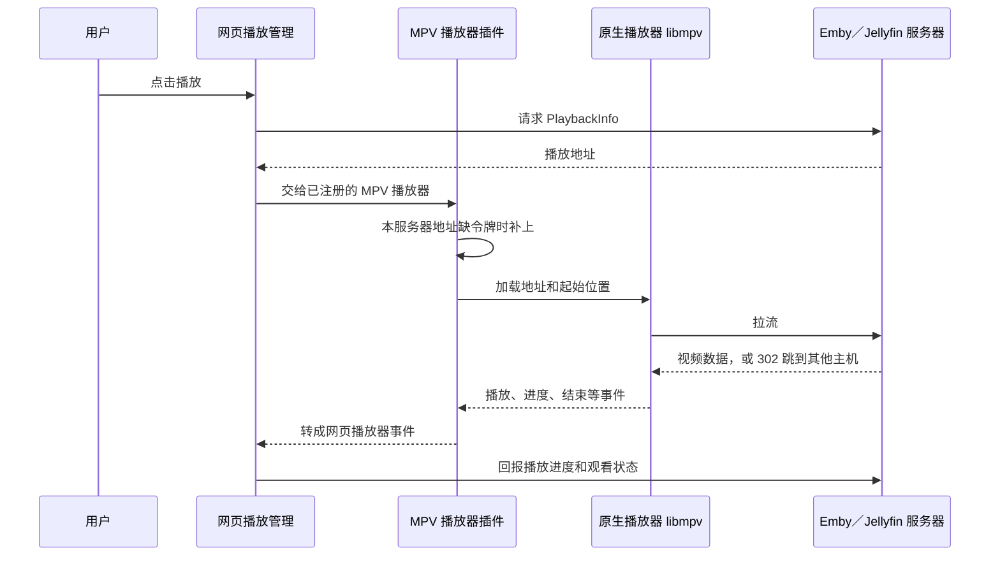

- 网页的播放管理器（Emby 与 Jellyfin 的流程相同）通过 PlaybackInfo 选择媒体源、音轨、字幕以及直接播放还是转码，并负责播放队列、上一集和下一集，以及向服务器回报进度。客户端向它注册一个 MPV 播放器，接管真正的解码和显示。
- **令牌：** 服务器给的播放地址不带令牌时（Emby 关闭了 AddApiKeyToDirectStreamUrl），插件只给与当前服务器同一来源的地址补上令牌，其他主机的地址原样交给播放器。桌面端再把令牌从地址里移到 `Authorization` 请求头；MPV 跟随 302 跳到其他主机时会丢掉这个请求头，所以令牌不会发给网盘或 CDN。日志里的令牌会被打码。
- **字幕：** 内嵌字幕由 MPV 直接读取；Emby 的外挂字幕按地址交给 MPV 加载。ASS 字幕由 libass 渲染，保留脚本自带的样式和字体。
- **画质预设：** 桌面、iPad 和 Apple TV 的画质档位是一组 MPV 着色器和缩放参数，在播放器里切换，不改变 Emby 返回的视频。

## 各客户端

### Windows

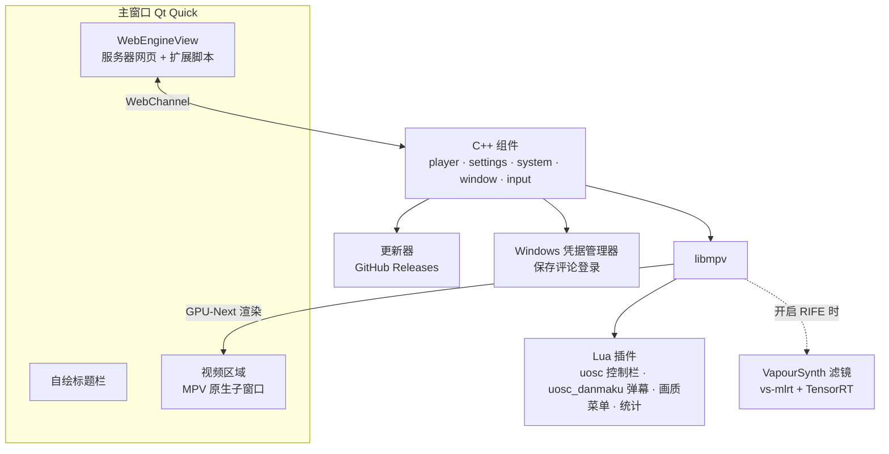

- **网页层：** 使用自建的 QtWebEngine 6.9，带本项目的补丁，例如把窗口所在屏幕的刷新率交给网页合成器，界面动画不再固定 60 帧。
- **视频层：** 默认由 MPV 的 GPU-Next 直接渲染到嵌在主窗口里的原生子窗口（`--wid`），播放时由 uosc 接管鼠标和键盘，网页在下面保持就绪，停止后立即回到媒体库。「libmpv Render API 兼容模式」改为把画面渲染进 Qt 场景，用于排查兼容问题。
- **播放控件和弹幕**由 MPV 里的 Lua 插件绘制，不是网页元素：uosc 提供控制栏和菜单，uosc_danmaku 用 MPV 的 ASS 叠加层显示弹幕。
- **配置档：** 每个配置档有独立的设置、网页数据和日志。安装版放在 `%LOCALAPPDATA%\Tigerest Theater`，便携版放在程序目录的 `data`。
- **RIFE：** 可选的 NVIDIA 扩展包含 Python、VapourSynth、vs-mlrt（TensorRT）和三个模型。开启后 MPV 通过 VapourSynth 滤镜把视频交给推理链；第一次使用某个模型和尺寸时构建 TensorRT 引擎并缓存。客户端负责下载、校验扩展和判断片源是否符合条件。
- **打包：** CMake + MSVC 构建，Inno Setup 制作安装器；便携 ZIP 与安装版内容相同，都自带运行库。

### Mac

Mac 与 Windows 是同一套 Qt 代码，区别主要在视频输出和补帧：

- **独立播放窗口：** macOS 的 Cocoa 不支持 MPV 的 `--wid` 嵌入，所以默认使用独立的 GPU-Next 播放窗口（Metal），停止后回到媒体库窗口。
- **随包 RIFE：** 同样通过 MPV 的 VapourSynth 滤镜接入，但滤镜是本项目自己的插件：Core ML 负责推理，Metal 负责光流变形等图像处理。只处理 1080p、30 fps 以内的逐行 SDR 恒定帧率视频，输出两倍帧率；其他视频原帧播放。
- **网页层：** 与 Windows 一样使用打过补丁的 QtWebEngine：补丁把播放窗口所在屏幕的 display link 交给 Chromium，网页动画跟随显示器刷新率（120 Hz 屏上约 120 帧）。Qt SDK 自带的引擎拿不到屏幕信息，只能固定 60 帧，所以打包脚本从验证过的发行包复制修补版引擎，前后核对它的 UUID，并把来源写进 `build-provenance.json`。
- **HDR：** 每次加载视频时，客户端检查播放窗口所在屏幕能否显示超过 SDR 白的亮度（EDR 余量）。能显示时（如 XDR 屏）关闭 MPV 的自动 ICC 配置，MPV 按片源选择 HDR10（PQ）交换链，并把 HDR 元数据交给 Core Animation，由系统映射到屏幕；普通 SDR 屏保留 ICC 色彩管理和 MPV 的色调映射。开始播放时用 MPV 的独立叠加层在右上角提示 4 秒输出方式，不占用弹幕插件使用的左上角消息位置。
- **更新：** 与 Windows 共用同一个 C++ 更新器和更新窗口，规则相同，只是选择 `arm64.dmg`，校验后打开 DMG。
- 评论登录保存在 Keychain。正式包只提供 Apple Silicon 版本，使用临时签名，未经 Apple 公证。

### Android

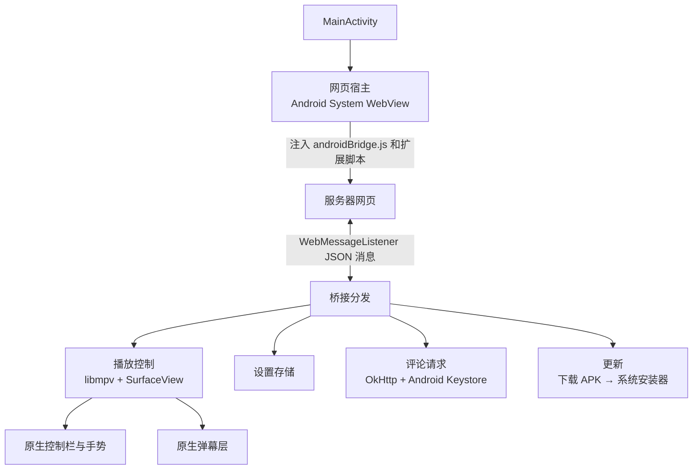

- 一个 Activity 承载全部界面：网页负责浏览和详情，播放时原生播放层盖在网页上方。
- libmpv 和 FFmpeg 动态库取自固定版本的 mpv-android 正式包，构建时核对哈希，并检查 16 KB 内存页对齐，以兼容使用 16 KB 页的新设备。
- 桥接请求按类型分线程：播放、设置和窗口操作在主线程上按顺序执行，避免旧影片的结束事件和新影片的加载交错；弹幕下载等网络请求在后台线程。
- 控制栏、手势（双击暂停、横滑跳转、亮度和音量、长按倍速、防误触锁）和弹幕都是 Kotlin 原生实现，不依赖 MPV 的 Lua 插件。
- 切到后台时暂停播放。暂不提供后台播放、画中画、离线下载和 RIFE。
- 应用内保留脱敏的诊断日志，「上报问题」时可以附带，不需要 ADB。

### iPad / iPhone

2.9.4 起同一个应用改为 iPhone／iPad 通用包（`universal.ipa`，应用标识 `top.tigerest.theater.universal`）。下文所说的 iPad 同样适用于 iPhone：网页在 iPhone 上按窄屏排版，竖屏播放器的控制栏分成时间和按钮两行。

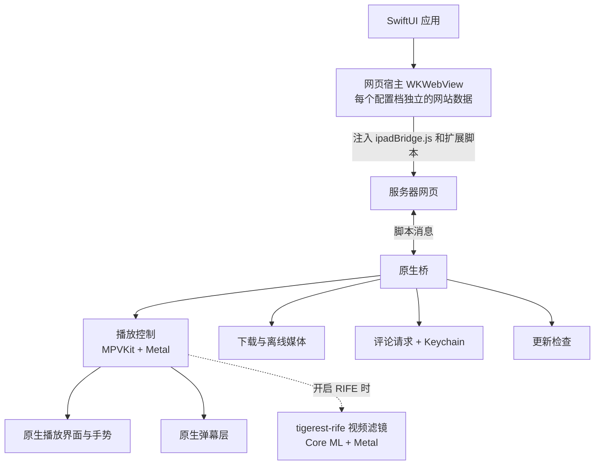

- 随包的页面和资源通过自定义的 `tigerest://` 协议提供；扩展脚本只注入到当前服务器的页面。
- 播放、手势、弹幕和离线媒体是 Swift 原生实现。弹幕使用独立的显示时钟和文字图层缓存，与 Apple TV 共用 AppleCore 中的匹配和排版代码。
- **RIFE：** 编译成 MPV 的视频滤镜，排在字幕和着色器之前，在独立线程上运行，经过有上限的异步队列与播放线程交换画面。VideoToolbox 解码出的 NV12（8 位）和 P010（10 位）画面由 Metal 转换成模型需要的浮点 RGB：P010 的 16 位采样先换算成 8 位刻度的浮点值，保留 10 位精度，再走与 NV12 相同的计算，结果与固定版本 swscale 逐像素一致（误差在 1/4096 以内）。其他格式或 Metal 失败时退回 swscale。随后由 Core ML 推理生成中间帧。只处理 1920×1080、BT.709 SDR、23–30 fps 的视频，固定两倍；其他格式原帧通过。在 23.976 fps 下每帧的处理预算是 41.7 毫秒：CPU 转换要 9–16 毫秒，整帧会接近或超过预算，Metal 转换约 3 毫秒，整帧约 30 毫秒。
- **HDR：** 屏幕的 EDR 余量大于 1（iPad Pro）时，MPV 打开色彩空间提示，播放图层允许 EDR，HDR10 与杜比视界以 10 位 PQ 输出；其他 iPad 色调映射到 SDR。开始播放时在画面上提示输出方式。
- **音频：** 优先使用 MPV 的 avfoundation 输出（AVSampleBufferAudioRenderer），保留 5.1／7.1 的声道布局交给系统，AirPods 等设备可以做空间音频；以前的 RemoteIO 输出在这类线路上只拿到两个声道。音频会话声明多声道内容，耳机或 AirPlay 连接变化时重新协商声道数。
- **键盘：** 接实体键盘时，方向键调音量、快进快退和按住倍速，空格播放／暂停；带修饰键的方向键保持系统作用。
- **更新：** 应用内只检查和提示新版本，版本信息同样先读社区服务签名的列表，连不上再问 GitHub。IPA 未签名，需要用自己的 Apple 身份签名安装，所以不能自动替换。

### Apple TV

tvOS 没有 WebKit，Apple TV 因此不加载服务器网页，全部界面用 SwiftUI 原生实现。

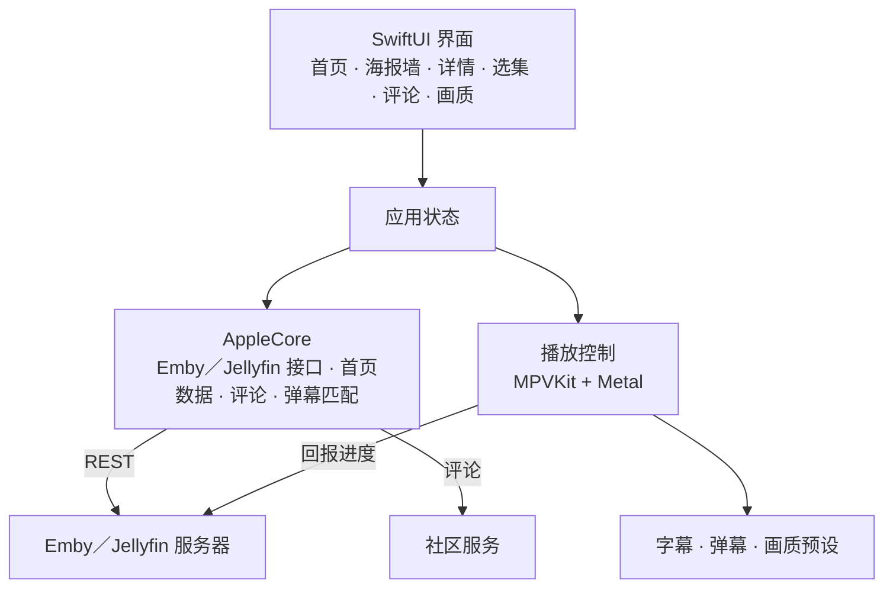

- 登录、首页、条目、PlaybackInfo 和进度回报由 AppleCore 直接调用服务器接口完成，与 iPad 共用同一个 Swift 包。AppleCore 从 `/System/Info/Public` 的产品名和版本号判断是 Emby 还是 Jellyfin，Jellyfin 下改用它的字段参数和条目类型。连接过的服务器保存在列表里，新地址确认可用后才替换当前会话。登录会话保存在 Keychain，不保存密码。
- 遥控器操作首页、海报墙和播放：播放和暂停、前后跳转 10 秒、上一集和下一集、选季选集。
- 画质分三档：原生、轻量增强、完整桌面滤镜。高帧率视频或持续掉帧时，轻量增强会临时降低当前视频的处理负载，选择本身不变。
- 播放器与 iPad 共用 MPV 引擎代码：音频同样优先使用 avfoundation 输出并声明多声道内容，AirPods 可以做空间音频；不启用 EDR 图层（tvOS 没有这个属性）。
- 不包含 RIFE 和一起看，也没有应用内更新检查。

## 一起看

一起看的客户端代码全部在共用扩展脚本里，所以 Windows、Mac、Android 和 iPad 用的是同一份实现：

- `watchTogetherClient.js`：REST 请求、WebSocket 连接、校时和断线重连；
- `watchTogetherSync.js`：同步引擎，让本机播放器跟上房间时间线；
- `watchTogether.js`：房间页、选片页、播放器里的提示。

Apple TV 没有网页层，线上房间服务也还不接受 tvOS 客户端，暂不提供。

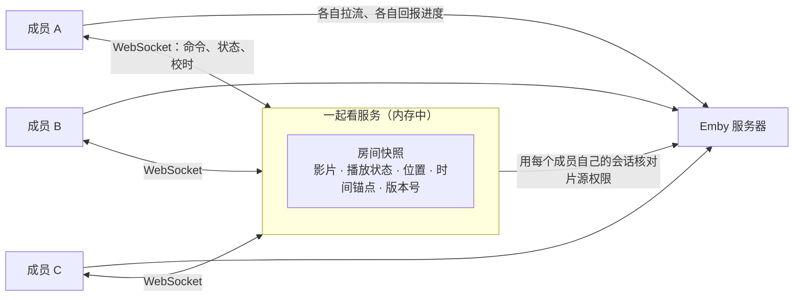

- **服务端是房间状态的唯一来源。** 它保存当前影片、播放状态，以及「某个服务器时刻对应的播放位置」这个时间锚点，按到达顺序处理命令再广播给所有人。房间只保存在内存里，服务重启后房间结束。
- **服务端不转发视频。** 每个成员各自从 Emby 拉流，各自回报观看进度。换片时服务端用每个成员自己的 Emby 会话核对能否播放新片，有人无权播放就拒绝换片。
- **身份：** REST 请求带当前大河 Emby 会话，服务端向 Emby 核实令牌的主人；WebSocket 连接使用一次性票据，令牌和票据都不放进网址。成员之间只能看到评论区的昵称、头像和客户端平台，看不到 Emby 用户 ID、设备 ID 或 IP。

### 一起开始

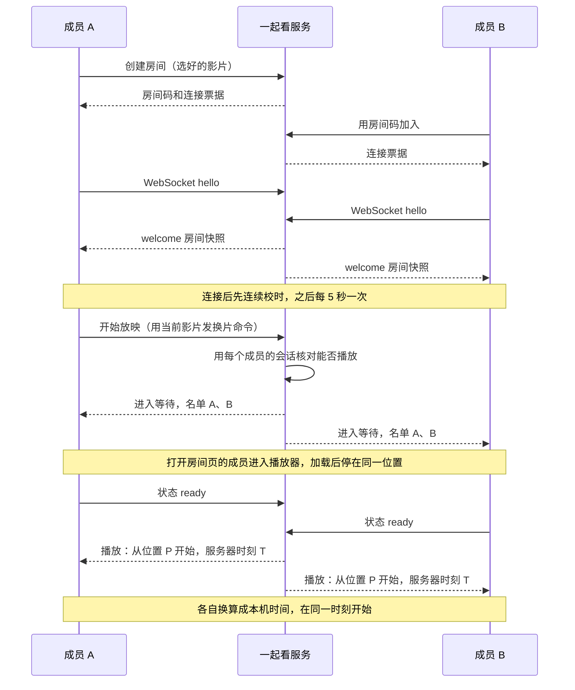

- **校时：** 客户端在本机时刻 t0 发出 ping，服务端在 r 收到、在 s 回复，客户端在 t3 收到回复。往返时间 = (t3 − t0) − (s − r)，时钟差 = ((r − t0) + (s − t3)) ÷ 2。客户端取最近 8 次中往返最短的一次作为时钟差，往返越短，估算越准。ping 同时充当心跳。
- **提前量：** 服务端把开始时刻定在「现在 + 提前量」，提前量 = 1.5 × 在线成员最大往返时间 + 150 ms，限制在 300–1200 ms，保证所有人在开始前收到消息。
- **加载等待：** 开始放映、拖动、换片时房间进入等待，所有人加载到同一位置后上报 ready。最多等 15 秒，没准备好的成员标为「落后」，其他人先开始，落后的成员准备好后自己跳到应处位置追上。

### 播放中的校正

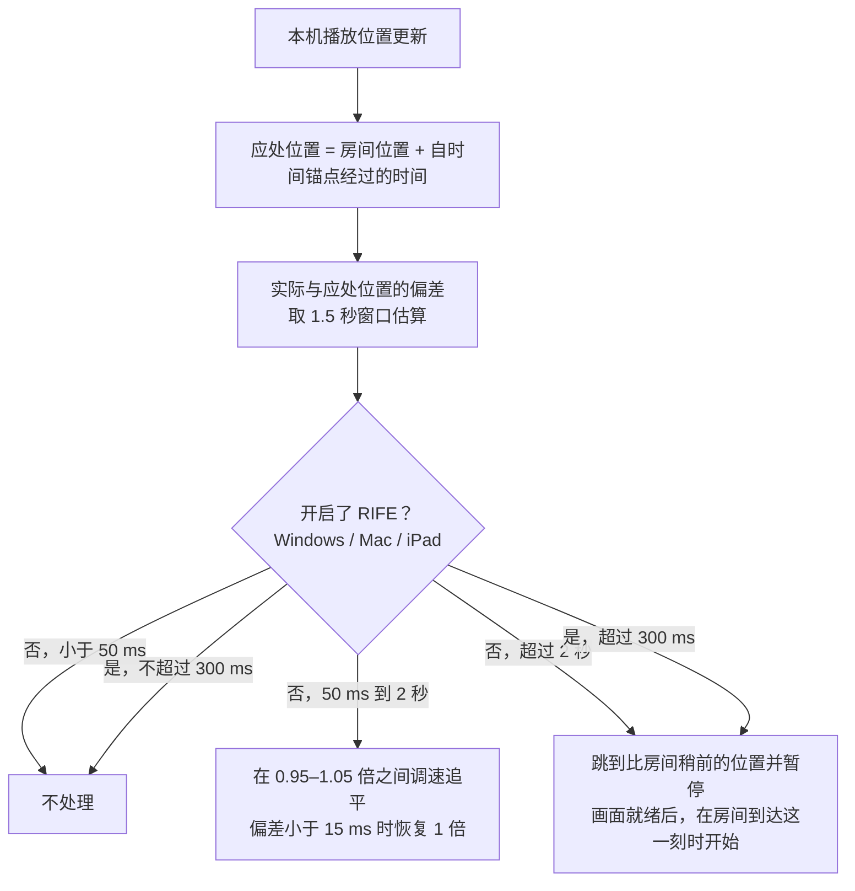

- 调速每秒最多调整一次，步长 0.5%。这些校正不发命令、不改变房间版本，只影响本机。
- 开启 RIFE 时，任何非 1 倍速都会让补帧暂停，所以 Windows、Mac、iPad 开启 RIFE 后不调速，偏差超过 300 ms 时直接用跳转方式对齐。
- 大偏差不直接跳到房间位置：先跳到稍前的位置暂停，等这一帧准备好，再在房间走到那里时开始播放，跳转本身耗时多久都不会影响结果。

### 操作与冲突

- 任何成员暂停、播放、拖动或换片时，本机先执行，再把命令发给服务端。命令带上客户端看到的房间版本号；两个人同时操作时，后到的命令版本已经过期，会被拒绝，客户端按最新状态显示并提示。
- 同步引擎自己执行的暂停和跳转会记为「预期动作」，播放器回报这些动作时不会被当成用户操作再发出去，避免互相回声。
- 某个成员连续缓冲 1.5 秒，全房间退回到他卡住的位置等待；同一个人 30 秒内再次缓冲时只把他标为落后，不再拖住所有人。
- 断线后自动申请新票据重连，用收到的完整快照恢复。断线成员的座位保留 60 秒；所有人都断线时房间保留 5 分钟。关闭播放器或 Android、iPad 切到后台时上报「未在观看」，不会让整个房间暂停。

## 公共评论与消息

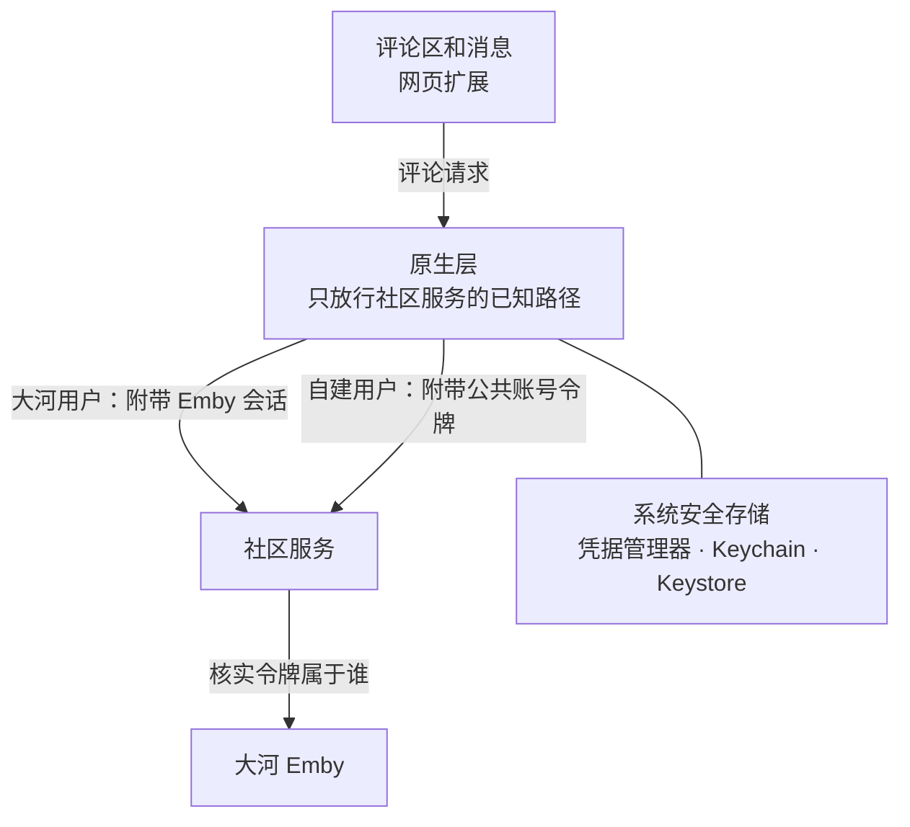

- **请求经过原生层：** 网页不直接请求社区服务，而是把请求交给原生层。原生层只放行社区服务的已知路径，从系统安全存储取出公共账号令牌加到请求上。令牌不进入网页存储；HTTPS 页面访问 HTTP 服务的混合内容限制也由此避开。
- **大河用户**带当前 Emby 会话的身份信息，社区服务向大河 Emby 核实令牌真正属于哪个用户，所以不需要注册。
- **自建用户**使用独立的公共账号，用用户名和密码换取访问令牌，过期前自动刷新。自建 Emby 的令牌、用户 ID 和地址不会发给社区服务。
- **话题匹配：** 电影和剧集按 TMDB 编号对应同一个公共话题，单集还要加上播出季集号。匹配不可靠时不合并，避免把不同作品混在一起。
- **头像：** 自建用户发言时，客户端读取自己 Emby 上的本人头像，生成小尺寸 PNG，只有服务端需要新图时才上传。
- Apple TV 没有网页层，由 AppleCore 的评论客户端直接请求，公共账号令牌单独保存在 Keychain。

## 弹幕

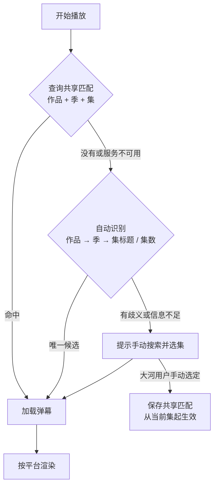

- **来源：** 大河弹幕网关提供与弹弹play 相同格式的搜索和下载接口，另有共享匹配接口；也可以添加视频网站来源或导入本地弹幕文件。
- **共享匹配**由服务端保存「原视频的季集」与「弹幕集」的对应关系，后续集数自动沿用，同一网关下的客户端共享。读取共享匹配不需要登录；保存需要大河 Emby 会话。
- **渲染：**

| 平台 | 弹幕怎样显示 |
| --- | --- |
| Windows、Mac | MPV 的 Lua 插件 uosc_danmaku，用 ASS 叠加层绘制 |
| Android | Kotlin 原生弹幕层，叠在播放画面上 |
| iPad、Apple TV | AppleCore 负责排版，原生文字图层绘制，使用独立的显示时钟 |

## 设置与配置档

- 设置项定义在一份描述文件里：分类、默认值、取值范围和说明。网页里的「播放器设置」分组和「媒体库设置」里的首页分类按这份描述生成，支持搜索、即时保存和恢复默认；设置值保存在原生层，Android 和 iPad／iPhone 只显示本平台支持的项。
- 桌面每个配置档有独立的设置、网页数据、缓存、离线文件和日志；iPad 每个配置档有独立的网站数据。
- 桌面只使用客户端目录中的一份 mpv.conf：头部和尾部管理区由 `MpvConfigManager` 在启动和相关设置变化时重写，中间的用户区由设置页编辑器修改。解析、校验和编辑在 `MpvConfDocument`，配置项归属（锁定、由其他设置页决定、RIFE 开启时暂停）定义在 `resources/mpvconf/options.json`。画质档由客户端按文件内容执行，保存后无需重启。

## 更新

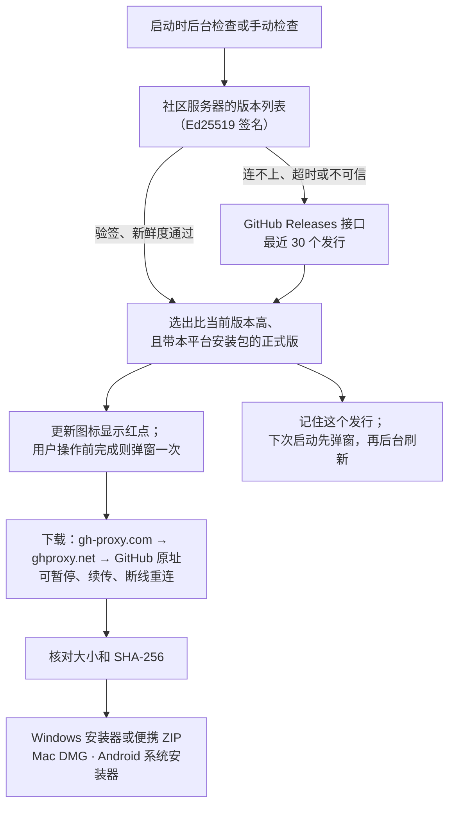

版本信息先向社区服务器要：服务器定时读取 GitHub 的发行列表，用 Ed25519 签名后提供给客户端，客户端用内置公钥验签，再检查数据新鲜度（最近一次读取 GitHub 不超过 72 小时）。连不上、10 秒内没有回应、被重定向、超过 2 MiB、验签失败或数据过期时，改为直接请求 GitHub 接口，用户看不到区别。这样多数用户不再占用 GitHub 的匿名额度，也不会再遇到「GitHub 请求受限」。签名只保证列表出自我们的服务器；安装包仍只从 GitHub 发行页（经加速镜像）下载，并按列表里的 SHA-256 核验。Windows 与 Mac 的验签代码在 `src/system/ReleaseFeed.cpp` 和 `Ed25519.cpp`，Android 在 `ReleaseFeed.kt` 和 `Ed25519.kt`，iPad／iPhone 在 AppleCore 的 `ReleaseFeed.swift`（用 CryptoKit 验签）；规则见 `docs/backend-app-release-feed.md`。

安装包依次从 GitHub 下载加速镜像 `gh-proxy.com`、`ghproxy.net` 和 GitHub 原址下载。正在出数据的来源断线后先在原处续传；还没出数据就失败、返回错误状态、不受信任的跳转或长度不对时立刻换下一个。镜像只负责传输：大小和 SHA-256 只取自版本信息（GitHub 接口或社区服务器签名转发的原值），经镜像下载的文件校验不通过时丢弃，只从 GitHub 原址重新下载一次。两个镜像转发 GitHub 的 ETag，续传可以跨来源；gh-proxy.com 对超过约 512 MB 的文件不支持断点续传，会从头重新下载。Windows RIFE 扩展的下载使用同一组镜像，校验值来自客户端内置的扩展目录。

发行页没有本平台安装包时，更新器直接跳过这个版本。Windows 与 Mac 共用同一个 C++ 更新器（`src/system/AppUpdater.cpp`）和网页更新窗口；Android 用 Kotlin 实现同样的规则。iPad／iPhone 只检查和提示，不下载安装；Apple TV 没有应用内更新检查。

找到的发行连同它的说明保存在本机偏好设置里（Windows/Mac：配置目录的 `app-update-preferences.json`；Android：`app-updates` 偏好）。下次启动先用完整的发行规则重新核对这份记录，已安装或已忽略的版本不会显示；后台刷新失败时保留记录和弹窗，刷新结果变化时替换或删除记录。

客户端内置夸克和百度网盘的固定分享文件夹，每个版本一个以版本号命名的子文件夹（如 `2.9.3`）。点网盘按钮时，客户端先匿名读取分享的文件列表（只读，不登录），在分享根目录及其下一层中找到这个版本的文件夹，再用浏览器打开它的网页（Windows/Mac：夸克 `#/list/share/<fid>`，百度 `/s/<分享码>#list/path=<路径>`；Android：百度手机页 `/wap/link?surl=<分享码>#/home/%2F/<路径>`。夸克手机页没有子文件夹地址，Android 上直接打开分享首页）；找不到、超时（10 秒）或网盘拒绝时打开整个分享。下载在网盘网页或应用里登录后进行，客户端不经手网盘账号。

需要换分享时，在 GitHub 发行说明里写一行隐藏注释，不在页面上显示：

```html
<!-- tigerest-mirrors {"quark":"https://pan.quark.cn/s/分享码","baidu":"https://pan.baidu.com/s/分享码?pwd=提取码"} -->
```

只接受 `https://pan.quark.cn/s/…` 和 `https://pan.baidu.com/s/…`（可带四位 `pwd`），其他地址被忽略并使用内置分享。带提取码的百度分享直接打开分享页，由网页要求输入提取码。每次发布时把发行文件上传到固定分享文件夹中以版本号命名的子文件夹。

## 隐私与安全边界

- 视频直接从 Emby 拉流，不经过本项目的服务。弹幕匹配会把作品名和季集发给弹幕服务，公共评论会用到作品的 TMDB 编号和季集；一起看服务只保存房间里的影片和播放状态。
- 日志里的令牌、密码和认证头会被打码；播放请求跳到其他主机时不带令牌。
- 社区服务收不到自建 Emby 的令牌、用户 ID 或地址；Emby 令牌不会发给公共评论和第三方弹幕来源。
- 原生桥只接受当前服务器来源的主框架页面，切换服务器后旧页面的请求作废。
- 「上报问题」附带的日志先脱敏，只有报错本人和后台所有者能读取，默认保存 30 天。

## 构建与测试

| 平台 | 构建 | 自动测试 |
| --- | --- | --- |
| Windows | CMake + MSVC，Qt 6.9 与自建 QtWebEngine，Inno Setup 打包 | CTest：C++ 单元测试、扩展脚本测试、QtWebEngine 界面测试、真实 MPV 播放测试、安装包检查 |
| Mac | 同一套 CMake 工程；打包时换入修补版 QtWebEngine | 同一套测试中适用于 Mac 的部分（2.9.4 共 87 项，含更新窗口界面测试）、打包检查 |
| Android | Gradle + Kotlin | JVM 单元测试、lint、签名和 16 KB 对齐检查 |
| iPad／iPhone、Apple TV | 由脚本生成 Xcode 工程，固定 MPVKit 版本 | AppleCore 的 Swift 测试、XCTest、Apple TV 遥控器界面测试、RIFE 调度测试、Metal 颜色转换与 swscale 的逐像素对照 |

每次发行附带 `RELEASE-MANIFEST.json`（苹果三端为 `APPLE-RELEASE-MANIFEST.json`），记录来源提交、测试结果和验证范围；测试用模拟数据还是真实服务器、真实播放，分开记录。构建说明见仓库中的 [Windows](https://github.com/Tigerest/Tigerest-Theater/blob/main/dev/windows/README.md)、[macOS](https://github.com/Tigerest/Tigerest-Theater/blob/main/dev/macos/README.md)、[Android](https://github.com/Tigerest/Tigerest-Theater/blob/main/android/README.md)、[iPad / iPhone](https://github.com/Tigerest/Tigerest-Theater/blob/main/docs/apple/INSTALL.md) 和 [Apple TV](https://github.com/Tigerest/Tigerest-Theater/blob/main/apple/TV/README.md)。
